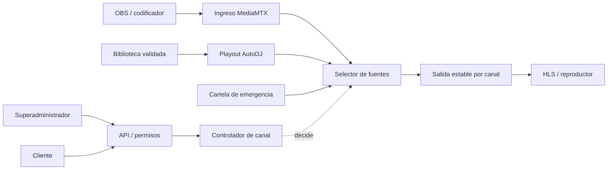

# Investigación funcional y propuesta de arquitectura

Fecha: 2 de noviembre de 2026.

## Alcance y evidencia

Objetivo: reconstruir las funciones relevantes para un proyecto personal: emisión en vivo, respaldo con videos cuando cae el directo y paneles de superadministrador y cliente.

Se consultó documentación pública oficial. No se obtuvo un paquete instalable de MediaCP, código de servidor, acceso autenticado a una instancia ni captura de tráfico. Por tanto, esto es una especificación funcional documentada, no una decompilación ni una verificación de su implementación interna. Las decisiones de OpenMediaCP que siguen son propuestas propias.

La carpeta inicial estaba vacía. Los instrumentos MCP de REA no están disponibles en la sesión. El diagnóstico CLI `rea-agents@6.7.0 doctor --client codex --json` encontró registro de Codex ausente; no se modificó configuración. No existen Evidence IDs de análisis REA del producto; los identificadores F1–F7 siguientes son referencias documentales locales.

## Hallazgos

| ID | Evidencia documental | Alcance / confianza |
|---|---|---|
| F1 | [Panel de video](https://www.mediacp.net/es/mediacp/video-streaming-panel-2/): panel instalable, servicios de video, límites de recursos, gestión de clientes/revendedores e integración con motores. | Declaración oficial; no prueba de ejecución. |
| F2 | [TV Station](https://www.mediacp.net/doc/video-broadcaster-guide/tv-station-overview/): canal permanente, listas programadas y predeterminada. El directo toma prioridad y al desconectarse vuelve la lista. | Responde directamente al respaldo solicitado. No documenta temporizadores ni posición de reanudación. |
| F3 | [Transiciones](https://www.mediacp.net/doc/video-broadcaster-guide/smooth-streaming-and-content-transition/): inconsistencias de formato pueden interrumpir reproducción; recomienda transcodificación y formatos consistentes. | No garantiza ausencia de cortes en una instalación concreta. |
| F4 | [Fallback Cloud](https://www.mediacp.net/cloud-video/fallback-video/): video de espera automático y retorno al directo. | Es Cloud Video; no trasladar automáticamente todos sus detalles al panel instalable. |
| F5 | [Diseño mediasoup](https://mediasoup.org/documentation/v3/mediasoup/design/) y [FAQ](https://mediasoup.org/faq/): SFU integrable en aplicaciones, sin mezcla ni transcodificación. | Adecuado para transporte interactivo, no resuelve por sí mismo el playout. |
| F6 | [MediaMTX always-available](https://mediamtx.org/docs/features/always-available): segmento offline repetido mientras no hay fuente; permite archivo MP4 externo y concatena sin recodificar. | Respaldo simple; no equivale a biblioteca y programación de AutoDJ. Compatibilidad real por validar. |
| F7 | [Configuración MediaMTX](https://mediamtx.org/docs/references/configuration-file): autenticación externa, permisos por ruta y servicios de streaming configurables. | Viabilidad documental de separar control y transporte; fijar versión al implementar. |

En video, el equivalente al AutoDJ es una estación de TV o VOD-to-live: reproduce videos de una biblioteca como una señal lineal. Para este proyecto se asume AutoDJ de video; audio con imagen o visualizador puede agregarse después.

## Decisión técnica propuesta

Empezar con **MediaMTX + FFmpeg + controlador propio de canales**. MediaMTX recibe y distribuye; FFmpeg inspecciona y normaliza archivos; un proceso de playout y conmutación mantiene la emisión. Evaluar GStreamer o Liquidsoap para ese proceso mediante una prueba real antes de fijarlo. Reiniciar FFmpeg por cada cambio de fuente no demuestra continuidad y no será el criterio de éxito.

Agregar mediasoup como adaptador opcional si se necesita estudio desde navegador, invitados o latencia interactiva. Requerirá señalización, manejo de sesiones y un puente al flujo de emisión. HLS seguirá siendo una salida útil para audiencia general. La salida WebRTC puede exigir otro perfil de audio; no asumir que AAC de HLS sea compatible con los navegadores.

Este diagrama separa responsabilidades; todavía no demuestra una implementación del selector.

## Política de respaldo propuesta

Prioridad automática: **directo saludable → programación vigente → playlist base → cartela de emergencia**. La suspensión administrativa prevalece sobre todas las fuentes. El cliente puede forzar AutoDJ o volver al modo automático.

Estados: `STOPPED`, `LIVE`, `SCHEDULED`, `AUTODJ`, `EMERGENCY`; salud de entrada y salida se registran por separado. Una conexión abierta no prueba que avancen los frames.

- Parámetros iniciales para ensayar: pérdida de medios durante 5 s activa respaldo; recuperación exige 10 s de avance continuo y un keyframe utilizable. Son valores de diseño, no mediciones de MediaCP.
- Validar timestamps, avance de video y audio, perfil permitido y generación de la conexión. Ignorar eventos tardíos de conexiones anteriores.
- Mantener una sola autoridad por canal mediante lease y fencing token. No permitir que dos workers publiquen simultáneamente a su salida.
- Preparar el respaldo antes de seleccionarlo; si falla un archivo, saltarlo. Si la lista no tiene contenido válido, usar cartela.
- Guardar cursor de playlist. Política inicial: retomar el clip interrumpido desde el comienzo; configurable más adelante. No atribuir este comportamiento a MediaCP.
- Conservar la URL pública durante el cambio. Manejar timestamps, keyframes, audio continuo y discontinuidades de HLS. Medir congelamientos en el reproductor.
- Supervisar la salida además del ingreso. Un AutoDJ activo con salida bloqueada debe generar recuperación del worker y evento de fallo.
- Reiniciar y reconciliar estado después de una caída del controlador. Registrar motivo, fuente anterior/nueva y tiempos de cada transición.

Un respaldo ubicado en el mismo servidor cubre pérdida del codificador; no cubre caída del servidor, red de salida o proveedor. Alta disponibilidad con un segundo nodo queda para otra etapa.

## Roles y aislamiento

| Función | Superadministrador | Cliente |
|---|---|---|
| Clientes, cuotas y suspensión | Todos | Consultar sus límites |
| Canales y estado | Todos | Solo canales propios |
| Archivos, playlists y programación | Todos, con auditoría | Solo sus recursos |
| Credenciales de publicación | Rotar/revocar por canal | Rotar las propias |
| Configuración de servidores | Sí | No |
| Eventos y consumo | Global y por cliente | Solo propios |

La autorización debe verificarse en servidor para cada recurso, tarea y acción multimedia, no solo ocultar controles. Resolver `tenant_id` desde la sesión y verificar pertenencia de canales y archivos. Claves únicas revocables por canal; publicaciones autenticadas y trabajadores con credenciales separadas. Nunca publicar claves de emisión en logs o URLs del reproductor.

Modelo inicial: `users`, `tenants`, `memberships`, `channels`, `stream_credentials`, `assets`, `playlists`, `playlist_items`, `schedule_entries`, `channel_policies`, `channel_runtime`, `transition_events`, `audit_events`. Todas las entidades del cliente llevan pertenencia explícita. Guardar fechas en UTC y zona IANA para calendario; probar cambios de hora de America/Santiago.

Stack de control propuesto: TypeScript, API con Fastify, PostgreSQL, panel Astro y almacenamiento local administrado al comienzo. Por instrucción del usuario, la interfaz se construye en Astro con HTML/CSS y JavaScript mínimo. Workers multimedia separados del proceso web. Redis solo cuando la cola o coordinación lo justifique. Despliegue objetivo inicial: un servidor Linux con contenedores; capacidad pendiente de mediciones.

## Primera versión y validación

1. Prueba multimedia de un canal: OBS, dos videos locales, respaldo, retorno y una URL HLS estable. Comparar loop simple de MediaMTX con playout de playlist; seleccionar motor según resultados.
2. API y persistencia: usuarios, dos roles, pertenencia, canal, clave de emisión, política de respaldo y eventos. Probar que un cliente no puede leer ni modificar recursos ajenos.
3. Biblioteca: subida con cuota, inspección, normalización, playlist ordenada y cartela. Archivos inválidos no pasan a reproducción.
4. Paneles: vista global para superadministrador; para cliente, estado, reproductor, emisión, biblioteca, playlist, política y eventos.
5. Programación y recuperación: calendario, reinicio de workers, respaldo persistente y métricas. Después: ABR, grabación, simulcast y adaptador mediasoup.

Pruebas necesarias antes de declarar el MVP operativo:

| Caso | Resultado exigido |
|---|---|
| Apagar OBS | Selección automática de respaldo y registro de latencia real. |
| Volver a conectar OBS | Retorno tras estabilidad mínima, sin oscilación repetida. |
| Entrada conectada sin avanzar medios | Detección independiente del estado TCP. |
| Archivos incompatibles o dañados | Rechazo/normalización o salto; cartela si no quedan válidos. |
| Cambios de fuente y reconexiones repetidos | Una URL de reproducción; medir gaps, A/V sync y continuidad. |
| Reiniciar controlador o worker | Recuperación y ausencia de dos publicadores de salida. |
| Cliente A solicita canal/archivo de B | Denegación en API, tareas y acceso multimedia privado. |

No fijar una promesa de transición imperceptible hasta medirla. Separar tiempo de detección, preparación, cambio y buffer del reproductor. Medir CPU, memoria y transferencia con el perfil y concurrencia objetivos antes de dimensionar servidor.

## Preguntas y límites al cierre

| Pregunta | Estado |
|---|---|
| ¿MediaCP documenta directo con retorno a playlist? | Respondida documentalmente: F2. |
| ¿Es viable separar administrador y cliente? | Diseño definido; implementación y pruebas pendientes. |
| ¿Mediasoup basta para AutoDJ? | No; requiere componentes adicionales: F5. |
| ¿Qué arquitectura probar primero? | Propuesta definida; rendimiento y continuidad sin verificar. |
| ¿Qué código/motor interno usa la instalación actual de MediaCP? | Sin resolver: no se analizó un artefacto ni instancia. |
| ¿Qué tiempos y reanudación exactos tiene MediaCP? | Sin resolver: exige observación de una instancia autorizada. |

Actualización: se implementó primero la interfaz Astro a petición del usuario. Incluye las dos vistas y navegación entre 10 páginas, configuración de fallback local y simulación de fuente. `astro check` pasó sin errores ni advertencias y la compilación generó 10 páginas. Se comprobó en navegador la simulación, persistencia tras recarga, búsqueda y menú móvil; el viewport de 390 px no presentó desbordamiento horizontal. El JavaScript compilado del resumen mide 3.268 bytes sin comprimir (1.445 bytes gzip). No se ha implementado ni probado el flujo multimedia, autenticación ni aislamiento de clientes. La siguiente entrega técnica pendiente es la prueba multimedia del punto 1.
